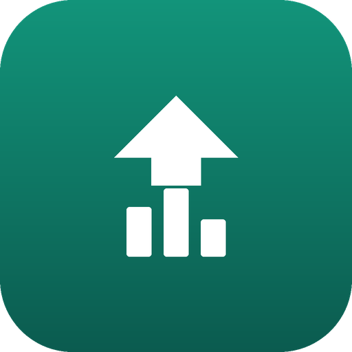
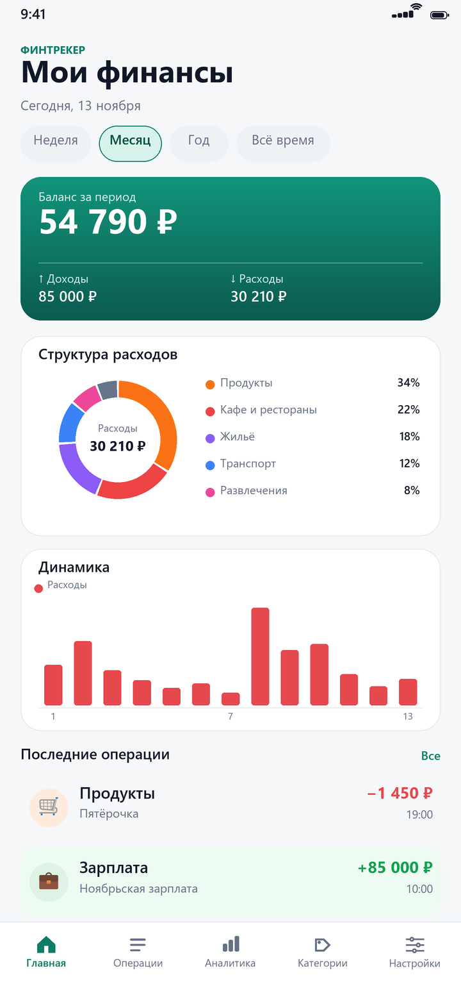
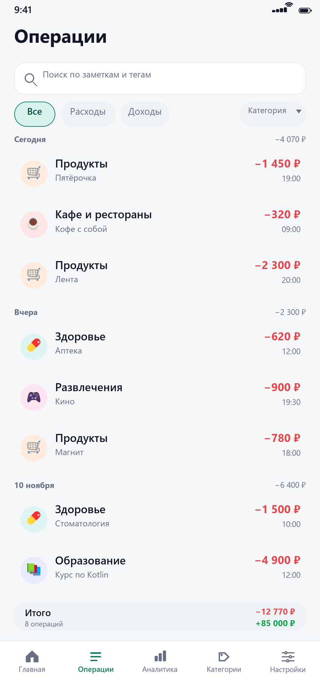
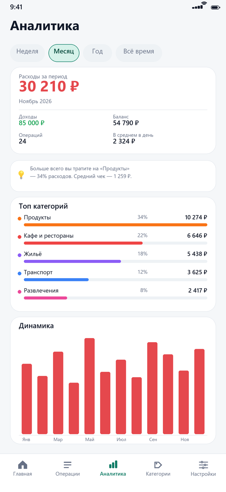
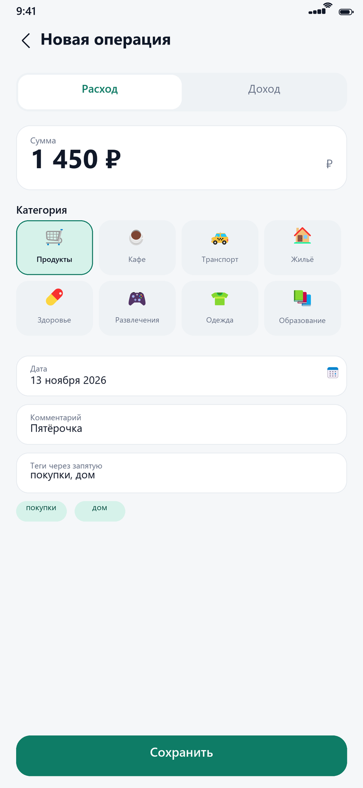
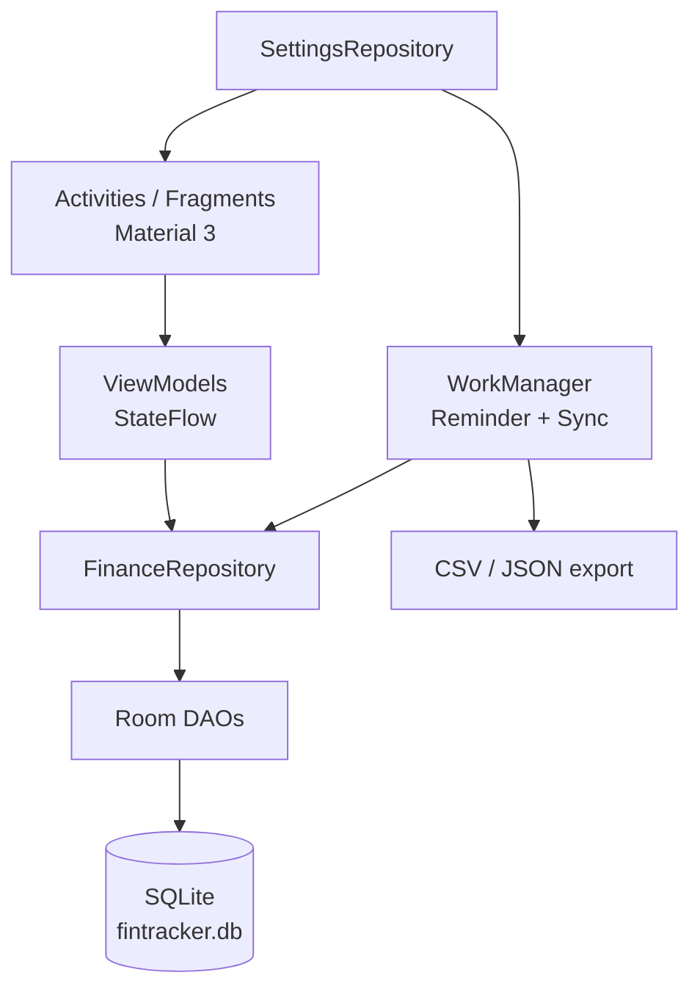

# ФинТрекер — трекер личных финансов

[](https://github.com/Croker0/fintracker/actions/workflows/android.yml)

Android-приложение для учёта доходов и расходов: категории, теги, быстрый ввод,
сводка по периодам, наглядные графики и экспорт отчёта.

Учебный командный проект: четыре участника, полноценный цикл — от анализа требований
и дизайна до Room-базы, фоновых задач и CI.

<p align="center">
  
</p>

## Возможности

- **Главный экран** — баланс за период, доходы/расходы, кольцевая диаграмма по категориям,
  график динамики и последние операции.
- **Операции** — список с разными типами ячеек (заголовок дня, расход, доход, итоги),
  поиск по заметкам/тегам/категориям, фильтры по типу и категории.
- **Быстрый ввод** — сумма, тип, категория, дата, комментарий и теги; редактирование и удаление.
- **Аналитика** — расходы, доходы, баланс, средний расход в день, топ категорий с прогрессом,
  инсайт «на что уходит больше всего» и график по месяцам.
- **Категории** — 15 стартовых категорий, свои категории с эмодзи и цветом, защита от удаления
  категорий с операциями.
- **Напоминания** — ежедневное уведомление в выбранное время через WorkManager.
- **Автосохранение** — периодическая фоновая задача формирует JSON-снимок данных.
- **Экспорт** — CSV для Excel/Google Таблиц и JSON-резервная копия через системное «Поделиться».
- **Тёмная тема**, Material 3, полностью русский интерфейс.

## Команда

| Участник | Роль | Зона ответственности |
|---|---|---|
| **Штефан** | Главный разработчик / тимлид | Архитектура MVVM, UI-слой, код-ревью, сборка и релиз |
| **Кислов** | Backend и база данных | Room, DAO, репозиторий, агрегации, WorkManager, экспорт |
| **Ибрагимов** | Аналитик | Требования, user stories, метрики, тест-план, приёмка |
| **Давлетханов** | Дизайнер | Визуальный стиль, палитра, макеты экранов, UX-тексты |

Кто чем занимается и как работает команда: [docs/TEAM.md](docs/TEAM.md).

## Макеты интерфейса

| Главная | Операции | Аналитика |
|---|---|---|
|  |  |  |

| Новый расход |
|---|
|  |

> Это дизайн-макеты, подготовленные по реализованным экранам (Material 3, светлая тема).
> Реальные скриншоты удобно добавить после запуска на устройстве: `adb exec-out screencap -p > screen.png`.

## Технологии

| Слой | Решение |
|---|---|
| Язык | Kotlin 1.9 |
| UI | Views, ViewBinding, Material 3, RecyclerView, кастомные View для графиков |
| Архитектура | MVVM + Repository, Coroutines/Flow, StateFlow |
| Данные | Room 2.6 (SQLite), KSP, внешние ключи, индексы, `@Relation`, `@Transaction` |
| Фон | WorkManager 2.9 (`CoroutineWorker`, периодические задачи, constraints) |
| Настройки | SharedPreferences + `StateFlow` |
| Экспорт | CSV (UTF-8 BOM, `;`), JSON (`org.json`), FileProvider |
| Сборка | Gradle 8.7, AGP 8.5, JDK 17, minSdk 24, targetSdk 34 |
| Тесты | JUnit 4 — 15 unit-тестов на деньги, агрегации и построение списка |
| CI | GitHub Actions: сборка APK + unit-тесты |

## Архитектура



- Данные наблюдаются через `Flow` из Room, агрегации считаются в SQL, а модели графиков
  собираются в `SummaryBuilder` на `Dispatchers.Default`.
- Все записи, затрагивающие несколько таблиц, выполняются в `database.withTransaction`.
- Графики — собственные `DonutChartView` и `BarChartView` на Canvas: без сторонних библиотек,
  с анимацией и корректным пустым состоянием.

Подробнее: [docs/ARCHITECTURE.md](docs/ARCHITECTURE.md).

## Быстрый старт

Требования: **Android Studio Ladybug или новее**, **JDK 17**, Android SDK **34**.

```bash
git clone https://github.com/Croker0/fintracker.git
cd fintracker
```

1. Откройте папку проекта в Android Studio.
2. Дождитесь синхронизации Gradle (все зависимости — из Google Maven и Maven Central).
3. Запустите конфигурацию `app` на эмуляторе или устройстве с Android 7.0+.

Сборка из консоли:

```bash
# Windows
gradlew.bat assembleDebug

# macOS / Linux
./gradlew assembleDebug
```

APK: `app/build/outputs/apk/debug/app-debug.apk`.

### Готовый APK

[dist/FinTracker-debug.apk](dist/FinTracker-debug.apk) — debug-сборка 1.0.0 (7,15 МБ).

```bash
adb install -r dist/FinTracker-debug.apk
```

Контрольная сумма и параметры сборки — в [dist/BUILD_INFO.txt](dist/BUILD_INFO.txt).

### Тесты

```bash
gradlew.bat testDebugUnitTest
```

Отчёт: `app/build/reports/tests/testDebugUnitTest/index.html`.

## Структура проекта

```
app/src/main/java/ru/fintracker/
├── core/                 # деньги, даты, форматирование
├── data/
│   ├── local/            # Room: entity, dao, database, converters
│   ├── model/            # Period, FinanceSummary, SummaryBuilder
│   ├── repository/       # FinanceRepository
│   ├── export/           # CSV, JSON, FileProvider
│   └── seed/             # демо-категории и операции
├── settings/             # SharedPreferences + StateFlow
├── ui/
│   ├── dashboard/        # главный экран
│   ├── transactions/     # список, фильтры, адаптер с 4 типами ячеек
│   ├── editor/           # создание/редактирование операции
│   ├── stats/            # аналитика
│   ├── categories/       # управление категориями
│   ├── settings/         # настройки, экспорт, демо-данные
│   ├── widget/           # DonutChartView, BarChartView
│   └── common/           # расширения UI
└── work/                 # WorkManager: напоминания и синхронизация
```

## Документация

- [Требования и user stories](docs/REQUIREMENTS.md) — Ибрагимов
- [Дизайн-система и экраны](docs/DESIGN.md) — Давлетханов
- [Архитектура и модель данных](docs/ARCHITECTURE.md) — Штефан, Кислов
- [Команда и процесс](docs/TEAM.md)
- [Вопросы на защите](docs/DEFENSE_QA.md)
- [План тестирования](docs/TEST_PLAN.md)
- [Публикация на GitHub](docs/GITHUB.md)
- [Презентация проекта](presentation/FinTracker.pptx)

## Данные и приватность

Приложение не отправляет данные в сеть. Демо-набор создаётся только при первом запуске;
его можно заменить или удалить в настройках. JSON-«синхронизация» — локальный снимок,
имитирующий облачное резервное копирование в учебных целях.

## Лицензия

MIT — см. [LICENSE](LICENSE).
