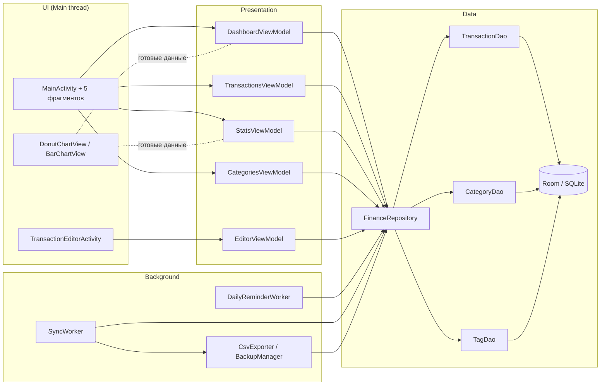
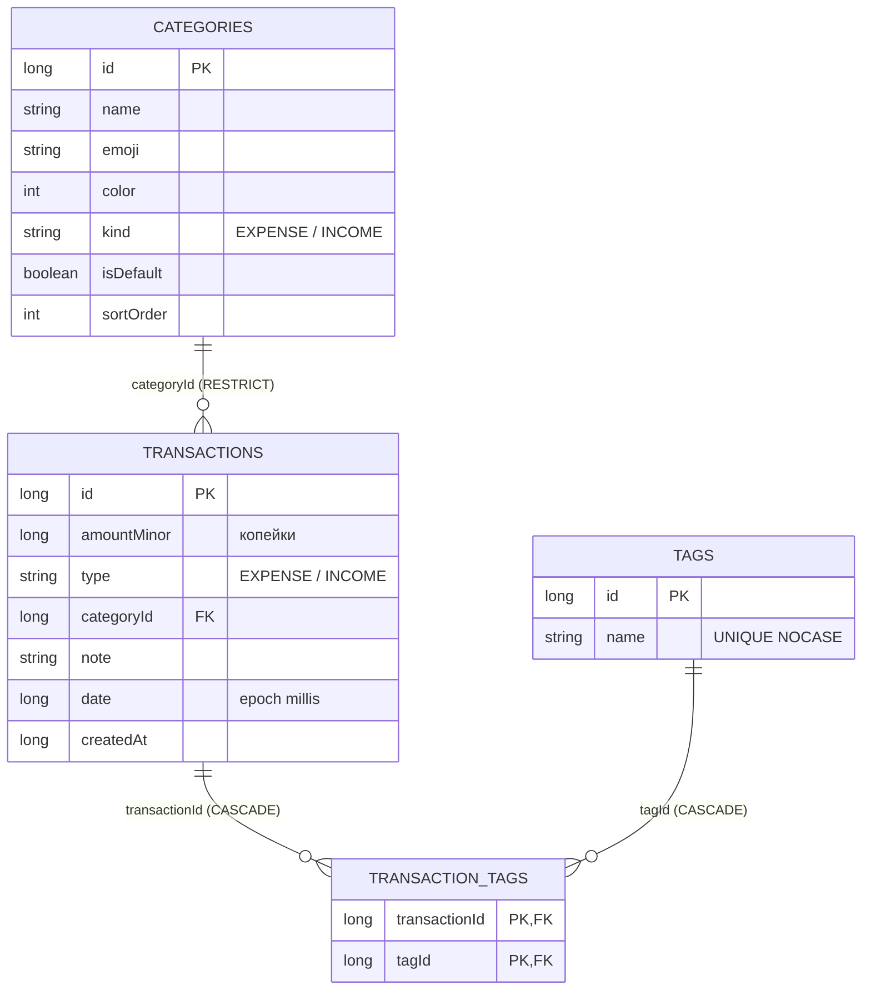

# Архитектура FinTracker

Документ описывает технические решения приложения: слои, модель данных, потоки,
фоновые задачи и компромиссы. Роли: Штефан (архитектура и UI), Кислов (данные и фон).

## 1. Общая схема



Принципы:

1. **Однонаправленный поток данных.** Room → Repository → ViewModel (`StateFlow`) → View.
   UI не обращается к DAO напрямую.
2. **ViewModel переживает поворот экрана.** Состояние периода и фильтров хранится в ViewModel.
3. **Тяжёлые вычисления — вне main thread.** Агрегации SQL выполняются Room на IO-пуле,
   сборка моделей графиков — `flowOn(Dispatchers.Default)`.
4. **Транзакционность.** Создание/обновление операции и тегов — одна `withTransaction`.
5. **Никакой сети.** Приложение полностью офлайн; «синхронизация» — локальный JSON-снимок.

## 2. Слои

| Слой | Пакет | Ответственность |
|---|---|---|
| UI | `ui.*` | Экраны, адаптеры, кастомные View, обработка ввода |
| Presentation | `ui.*ViewModel` | Состояние экрана, фильтры, `StateFlow`, вызовы repository |
| Domain/Data | `data.repository` | Операции над данными, бизнес-правила, сиды, экспорт |
| Local | `data.local` | Room: сущности, DAO, конвертеры, схема |
| Model | `data.model` | `Period`, `FinanceSummary`, `SummaryBuilder` — чистый Kotlin |
| Core | `core` | `Money`, `Dates` — форматирование и парсинг |
| Background | `work` | WorkManager, уведомления, планирование |
| Settings | `settings` | SharedPreferences + `StateFlow<AppSettings>` |

## 3. Модель данных



Решения:

- **Деньги в копейках (`Long`).** Исключает ошибки округления `Double`; на границе UI —
  `BigDecimal` и русский формат `1 250,50 ₽`.
- **Дата — epoch millis.** Удобно для `BETWEEN` и сортировки; группировка по дням/месяцам
  выполняется SQLite (`strftime(..., 'localtime')`).
- **Теги — M2M.** Нормализованная схема `tags` + `transaction_tags`; имя тега уникально
  без учёта регистра, при удалении операции связи удаляются каскадно.
- **Категория — внешний ключ с `RESTRICT`.** Нельзя удалить категорию, пока в ней есть операции.
- **Индексы** по `categoryId`, `date`, `type`, `tagId`; уникальные индексы
  `(name, kind)` для категорий и `name` для тегов.

Схема Room экспортируется в `app/schemas/` — это база для будущих миграций.

## 4. Ключевые запросы

```sql
-- Итоги периода
SELECT SUM(CASE WHEN type='EXPENSE' THEN amountMinor ELSE 0 END) AS expense,
       SUM(CASE WHEN type='INCOME'  THEN amountMinor ELSE 0 END) AS income,
       COUNT(*) AS count
FROM transactions WHERE date BETWEEN :from AND :to;

-- Разрез по категориям
SELECT type, categoryId, SUM(amountMinor) AS total
FROM transactions WHERE date BETWEEN :from AND :to
GROUP BY type, categoryId;

-- Динамика по дням
SELECT strftime('%Y-%m-%d', date/1000, 'unixepoch', 'localtime') AS day, ...
FROM transactions WHERE date BETWEEN :from AND :to
GROUP BY day;
```

`SummaryBuilder` (чистый Kotlin) превращает эти строки в `FinanceSummary`:
списки категорий, точки графика, средний расход в день. Благодаря отсутствию Android API
он покрыт локальными unit-тестами.

## 5. Экранные потоки

### Главная

`DashboardViewModel` хранит выбранный `Period`, через `flatMapLatest` переключает
`Flow<FinanceSummary>`. Дни/месяцы для графика выбираются по периоду:
неделя и месяц — по дням, год и «всё время» — по месяцам (12 месяцев).

### Операции

Один `Flow` всех операций + `Flow` категорий + три `MutableStateFlow` (поиск, тип, категория).
`TransactionListBuilder` фильтрует, группирует по дате и добавляет заголовки/итоги.
`ListAdapter` с `DiffUtil` поддерживает 4 типа ячеек: заголовок дня, расход, доход, итоги.

### Редактор

`TransactionEditorActivity` + `EditorViewModel`. Категории фильтруются по типу операции.
Сумма парсится в копейки, дата хранится как начало дня (для новых операций сохраняется
текущее время, для прошлых — полдень). Теги нормализуются: trim, lower-case, до 6 штук.

### Аналитика

Тот же `observeSummary(period)`. Дополнительно считаются проценты и инсайт на основе
самой крупной категории; прогресс-бары нормируются к максимальной категории.

### Категории

`combine(categories, usage)` даёт количество операций и сумму по категории. Диалог создания
и редактирования проверяет уникальность имени, запрещает менять тип категории с операциями
и удалять стандартные/используемые категории.

## 6. Фоновая работа

| Задача | Класс | Период | Условия |
|---|---|---|---|
| Ежедневное напоминание | `DailyReminderWorker` | 24 ч, initial delay до выбранного времени | без ограничений |
| Автосохранение | `SyncWorker` | 6 ч | `NetworkType.CONNECTED` |

- Уникальные работы (`enqueueUniquePeriodicWork`) с `UPDATE`, чтобы смена времени
  не плодила дубликаты.
- Канал уведомлений создаётся в `Application`; на Android 13+ запрашивается
  `POST_NOTIFICATIONS`, перед показом проверяется разрешение.
- `SyncWorker` пишет `filesDir/backups/latest.json` и обновляет `lastSyncAt` в настройках.
  Это осознанная имитация облака: учебный проект не содержит сервера.

## 7. Экспорт

- **CSV**: UTF-8 с BOM, разделитель `;`, десятичная запятая — открывается в русском Excel.
  Файл кладётся в `cacheDir/exports`, отдаётся через `FileProvider` и `ACTION_SEND`.
- **JSON**: схема `schemaVersion`, `exportedAt`, `totals`, массив операций с тегами.
  Используется и для фонового снимка, и для ручной выгрузки.

## 8. Обработка ошибок

- Валидация ввода — на уровне UI/ViewModel (сумма > 0, категория выбрана, имя не пустое).
- Бизнес-ошибки репозитория возвращаются как `Result<T>` с русским сообщением;
  UI показывает их в поле или `Snackbar`.
- `SyncWorker` при исключении возвращает `Result.retry()`.
- Пустые состояния предусмотрены для графиков, списка и топа категорий.

## 9. Производительность

- Список операций — `ListAdapter` + `DiffUtil`, без пересоздания всех элементов.
- Графики рисуются на Canvas, анимация — `ValueAnimator`; данные подготавливаются заранее.
- Агрегации — в SQL, а не перебором всех операций в Kotlin.
- `StateFlow` с `WhileSubscribed(5_000)` останавливает подписки при уходе с экрана.
- `viewBinding` исключает `findViewById` и утечки через nullable-биндинги.

## 10. Компромиссы и развитие

| Решение | Почему | Что дальше |
|---|---|---|
| Кастомные графики вместо MPAndroidChart | меньше зависимостей, полный контроль стиля | line chart и сравнение периодов |
| JSON-«синхронизация» локально | нет сервера в учебном проекте | Retrofit + backend Кислова |
| SharedPreferences вместо DataStore | минимальный объём настроек | DataStore при росте настроек |
| Один модуль `:app` | небольшой проект | `:core`, `:data`, `:feature-*` при масштабировании |
| Без Hilt | меньше порог входа для команды | DI при появлении второго источника данных |
