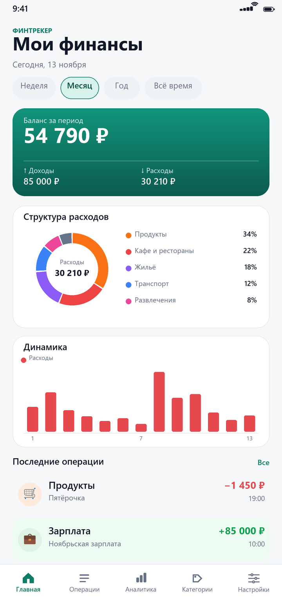
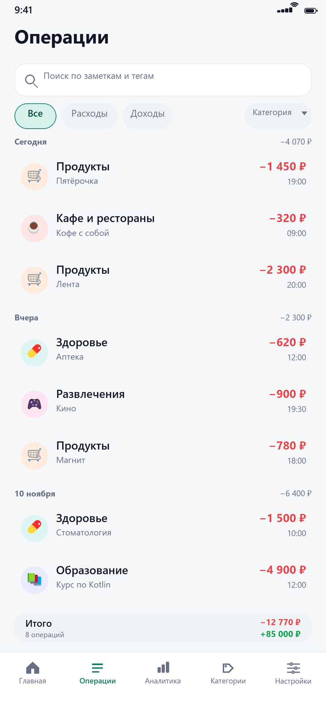
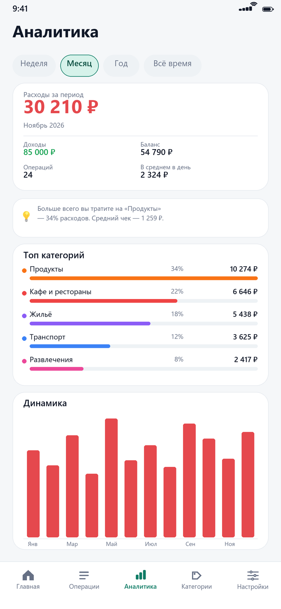
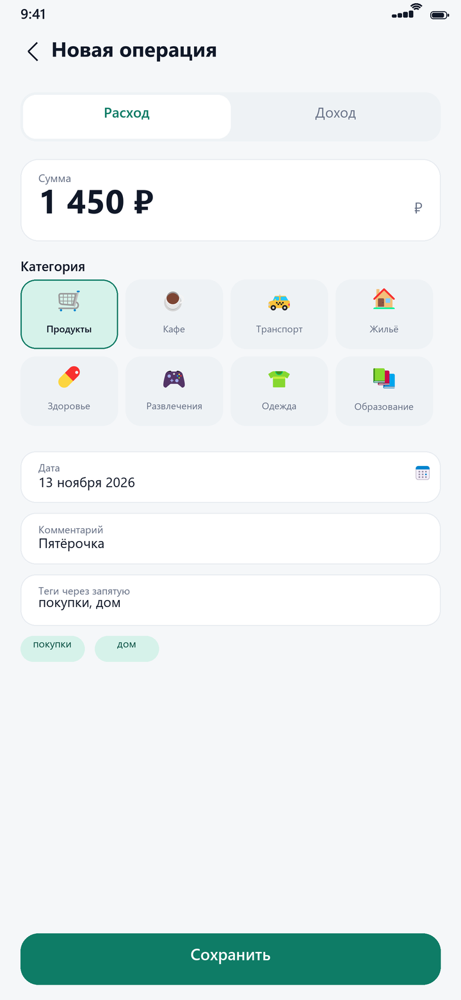

# Дизайн-система FinTracker

**Автор:** Давлетханов (дизайнер)  
**Подход:** спокойный финтех без «кричащих» акцентов; деньги — главный герой, декор — второй план.

## 1. Идея

> «Спокойные деньги»: мягкий тёмно-зелёный, много воздуха, крупные суммы,
> понятная иерархия и ни одного лишнего действия на пути к записи траты.

Ключевые принципы:

1. **Один экран — одна задача.** Главная отвечает «сколько у меня и куда уходит»,
   операции — «что было», аналитика — «почему так».
2. **Сумма важнее украшений.** Крупный кегль, табличные цифры, высокий контраст.
3. **Цвет — смысл, а не декор.** Зелёный = доход, красный = расход, бирюзовый = бренд/действие.
4. **Дружелюбная пустота.** Пустые состояния объясняют, что сделать дальше.
5. **Доступность.** Контраст, крупные touch-зоны (≥ 44 dp), подписи к иконкам.

## 2. Палитра

| Роль | Светлая тема | Тёмная тема | Использование |
|---|---|---|---|
| Brand / primary | `#0E7C66` | `#2DD4BF` | кнопки, активный таб, ссылки |
| Brand dark | `#0A5F4F` | `#14B8A6` | градиент баланса |
| Primary container | `#D6F2EA` | `#123F38` | выбранные чипы, иконки категорий |
| Accent | `#F2A33A` | `#FBBF24` | второстепенный акцент |
| Background | `#F5F7F9` | `#0B1220` | фон экранов |
| Surface | `#FFFFFF` | `#121B2B` | карточки |
| Surface variant | `#EEF2F5` | `#1A2639` | поля, чипы, треки прогресса |
| Text primary | `#101828` | `#EAF0F7` | заголовки, суммы |
| Text secondary | `#667085` | `#93A4BC` | подписи |
| Divider | `#E4E7EC` | `#22304A` | границы карточек |
| Income | `#12A150` | `#3DD68C` | доходы |
| Expense | `#E5484D` | `#FF6B6B` | расходы |

Категории: оранжевый `#F97316`, красный `#EF4444`, синий `#3B82F6`, фиолетовый `#8B5CF6`,
бирюзовый `#14B8A6`, розовый `#EC4899`, янтарный `#F59E0B`, индиго `#6366F1`,
пурпурный `#A855F7`, небесный `#0EA5E9`, зелёный `#16A34A`, серый `#64748B`.

## 3. Типографика

Системный шрифт (Roboto / SF / Segoe) — быстрый старт и нативная читаемость.

| Стиль | Размер | Начертание | Где |
|---|---|---|---|
| Display / баланс | 34 sp | Bold | сумма баланса |
| H1 | 28 sp | Bold | «Мои финансы», заголовки экранов |
| H2 | 16–18 sp | Bold | заголовки карточек |
| Body | 14 sp | Regular | текст, поля |
| Caption | 11–12 sp | Regular | подписи, проценты |
| Label | 11 sp | Bold, letterSpacing 0.08 | секции настроек |

Числа — с `fontFeatureSettings="tnum"`, чтобы разряды не «прыгали» при обновлении.

## 4. Сетка и формы

- Базовый шаг — **4 dp**; экранные отступы — **20 dp**, между карточками — **12–16 dp**.
- Радиусы: карточки — **20 dp**, поля и чипы — **14 dp**, кнопки — **16 dp**, иконки — круг.
- Высота кнопок — **52–56 dp**, touch-зона иконок — **40–44 dp**.
- Тени почти не используются: карточки отделяются 1 dp-границей и фоном.

## 5. Компоненты

### Карточка
Белая поверхность, радиус 20 dp, граница `divider`, без тени. Внутренние отступы 16–20 dp.

### Баланс
Градиент `#12947A → #0B5B4F`, белый текст, крупная сумма, разделитель и две колонки
«Доходы / Расходы». Это единственный насыщенный блок на главной — визуальный якорь.

### Чипы периода
Material 3 Filter Chip. Выбранный — `primaryContainer` с бирюзовой обводкой,
невыбранный — `surfaceVariant`. Всегда выбран ровно один.

### Строка операции
Круг 44 dp с эмодзи категории на фоне 16% от её цвета; название категории, заметка,
время и сумма. Доход — светло-зелёная подложка и зелёная сумма со знаком `+`.

### Графики
- **Donut** — топ-5 категорий + «Другое»; толщина кольца 14% диаметра, зазор 2.5°,
  в центре — сумма расходов. Анимация раскрытия 650 мс.
- **Bars** — расходы по дням/месяцам; скруглённые столбцы, 4 линии сетки,
  подписи не чаще 6 штук. Анимация роста 600 мс.

### Пустые состояния
Крупный эмодзи, короткое объяснение и кнопка действия. Никаких серых «заглушек» без выхода.

## 6. Экраны

| Экран | Главный вопрос пользователя | Ключевые блоки |
|---|---|---|
| Главная | «Сколько у меня и куда уходит?» | баланс, период, donut, динамика, последние операции |
| Операции | «Что я тратил?» | поиск, фильтры, группы по датам, итоги |
| Редактор | «Как записать трату?» | тип, сумма, категория, дата, заметка, теги |
| Аналитика | «Почему так вышло?» | сводка, инсайт, топ категорий, месячная динамика |
| Категории | «Как организовать учёт?» | список, цвет, эмодзи, тип |
| Настройки | «Как настроить под себя?» | напоминание, автосохранение, экспорт, демо, очистка |

### Макеты

## 7. Тёмная тема

- Фон `#0B1220`, поверхности `#121B2B`, границы `#22304A`.
- Бренд становится светлее (`#2DD4BF`), чтобы сохранить контраст на тёмном.
- Красный и зелёный осветляются; графики используют те же категориальные цвета,
  но с проверкой контраста к фону.
- Градиент баланса остаётся тёмно-зелёным — это «фирменное» пятно.

## 8. Анимации

| Элемент | Длительность | Кривая |
|---|---|---|
| Появление графика | 600–650 мс | Decelerate |
| Смена вкладки | мгновенно / fade | — |
| Нажатие | ripple Material 3 | — |

Анимации не блокируют ввод и не мешают повторным открытиям экрана.

## 9. Доступность

- Контраст основного текста к фону — не ниже 4.5:1.
- Все иконки-кнопки имеют `contentDescription`.
- Графики озвучиваются через `contentDescription` (сумма и список категорий).
- Размер интерактивных элементов — не меньше 44×44 dp.
- Цвет не является единственным носителем смысла: доходы/расходы подписаны и имеют знак.
